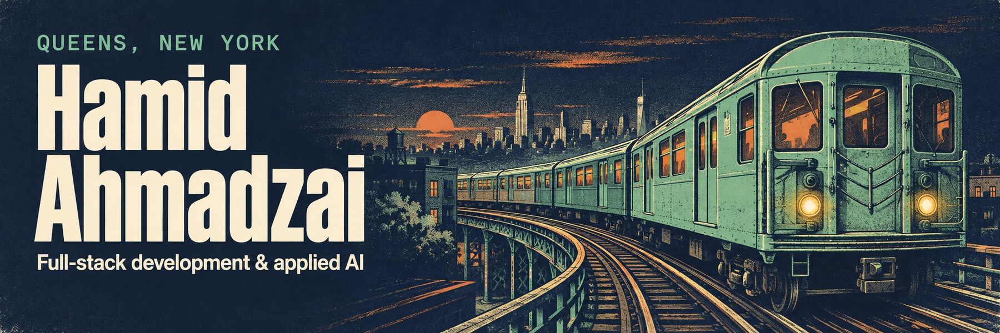
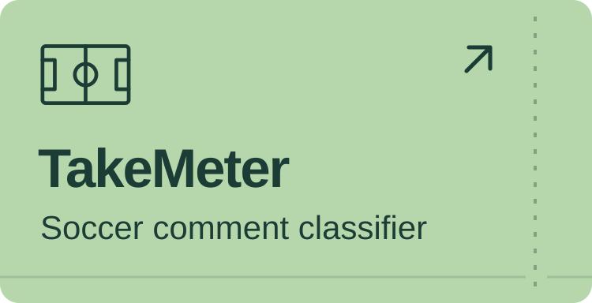
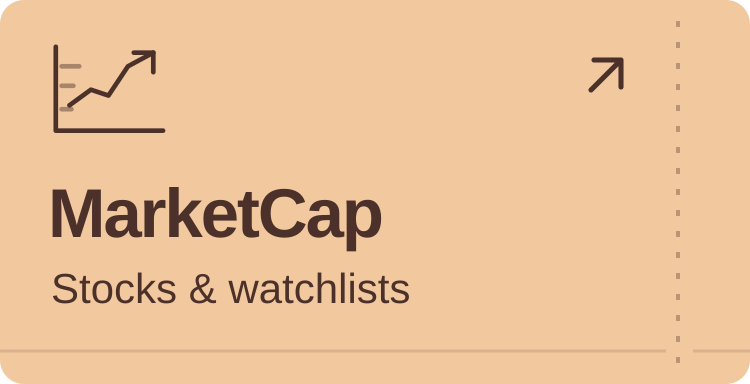
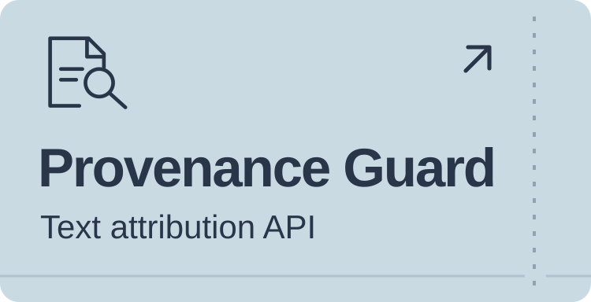

I’m Hamid, a computer science student at **CUNY Queens College**. I build web apps and train models on things I’m curious about. TakeMeter started with a soccer question. Can a model tell when a fan is breaking down a match and when they’re just venting?

## Selected work

<strong>A closer look at the builds</strong>

- **TakeMeter** — I hand-labeled 200 soccer comments and fine-tuned DistilBERT. Reading the mistakes was my favorite part. The model often treated hot takes as analysis just because they sounded technical.
- **MarketCap** — I built stock charts and personal watchlists in Next.js and designed a data layer that can switch between two providers to work within their rate limits. [Open MarketCap](https://finance-website-olive.vercel.app/)
- **Provenance Guard** — I built a Flask API that estimates whether text was AI-generated. It logs each decision and gives writers a way to appeal a flag.

**Tools I use** &nbsp; `TypeScript` · `Next.js` · `Python` · `SQL` · `Docker` · `Google Cloud`

I’m looking for **2027 software engineering internships and new-grad roles**, especially on full-stack or backend teams in NYC.
